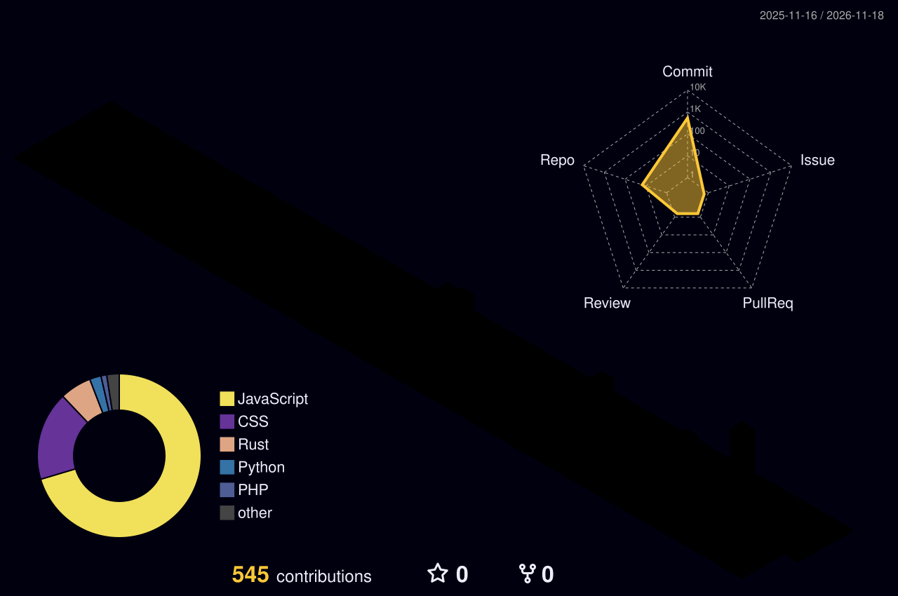

  <h1>Murilo Trigo</h1>
  
  

    
  

  

    
    
    
  

---

### 👨‍💻 Sobre Mim

Desenvolvedor **Full Stack** formado em Ciência da Computação pela **UNIP**, com 5 anos em sistemas web, ERP e área fiscal. Atuo da modelagem de dados à interface, com APIs, regras de negócio e integrações. Hoje também crio sites, landing pages e experiências interativas, aplicando IA no desenvolvimento e em automações.

* **Desenvolvimento Full Stack:** APIs REST com **Node.js** e **NestJS**, front-end em **React**, **Angular** e **TypeScript**, manutenção e evolução de sistemas web em **PHP**, regras de negócio e integração entre front-end e back-end.
* **Sistemas ERP & Fiscais:** Sistemas de **NF-e**, **SPED** e regras tributárias, relatórios, otimização de consultas em **PostgreSQL** e **MySQL** e integração com **AWS S3 e SES**.
* **Web, Cloudflare & IA:** Sites, landing pages, experiências interativas e minigames para campanhas, CRM de leads na **Cloudflare (Workers + D1)** integrado aos formulários do site e **IA aplicada** ao desenvolvimento e a automações.

---

### 🛠️ Tech Stack & Ferramentas

  

 

| Área | Tecnologias |
| :--- | :--- |
| **Backend** | Node.js, NestJS, PHP, Python, APIs REST |
| **Frontend** | React, Angular, TypeScript, JavaScript (ES6+), HTML, CSS |
| **Bancos de Dados** | PostgreSQL, MySQL, Otimização de Consultas SQL |
| **Nuvem** | Cloudflare (Workers, D1, Pages), AWS (S3, SES) |
| **DevOps & Ferramentas** | Git, GitHub Actions, IA aplicada ao desenvolvimento |

---

### 📊 Sequência de Contribuições & Atividade

  

  

